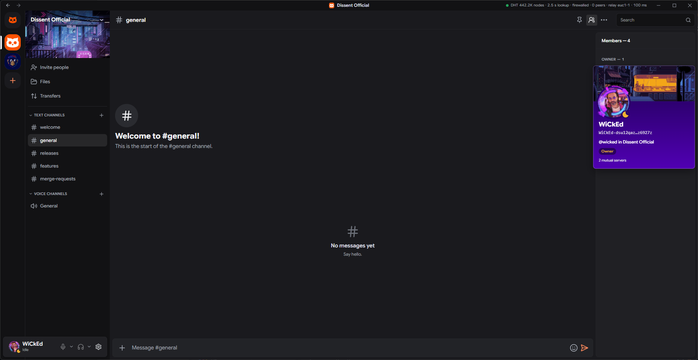

<p align="center">
  
</p>

<h1 align="center">Dissent</h1>

<p align="center"><strong>A place to talk with your communities that no company owns and nobody can switch off.</strong></p>

<p align="center">
  <a href="https://github.com/Kaakati/dissent/releases/latest"></a>
  <a href="https://github.com/Kaakati/dissent/actions/workflows/release.yml"></a>
  <a href="#license"></a>
</p>

<p align="center">

[![Join on Dissent][join-badge]][join]

Have the app? Open **Join server** and paste this link: `dissent://invite/dss1pwq48a5vtxxfqgp8q23ztvvyx4wcnc7qewvpf7z3zex00sg66dnq0hf6cs.cmyq6evdjk6kl64a73qtdvqdkxhl646nu2mp3gggjhsxjbc56giq.0.gl4mkxwx4mqhyhjqhakel2j47u`

</p>

Dissent is a free, open-source chat app in the spirit of Discord: servers, text and voice channels, direct and group messages, voice and video calls, screen sharing and file sharing. It has no central server. Communities live on the devices of the people in them, and the app connects those people directly, end-to-end encrypted.

It is written in Rust, with a desktop app built on [Tauri 2](https://tauri.app) and a React interface.

<p align="center">
  
</p>

> [!IMPORTANT]
> **Dissent is early-stage software and has not had a security audit.** Servers, encrypted chat, direct messages, calls and file sharing work today between people who run it, but please don't rely on it yet for anything sensitive. See [Security model](#security-model) and [Known limits](#known-limits).

## Contents

- [Why Dissent](#why-dissent)
- [How it works](#how-it-works)
- [Features](#features)
- [Security model](#security-model)
- [Download and install](#download-and-install)
- [Optional helpers anyone can run](#optional-helpers-anyone-can-run)
- [Build from source](#build-from-source)
- [Architecture](#architecture)
- [Project status](#project-status)
- [Contributing](#contributing)
- [Reporting a vulnerability](#reporting-a-vulnerability)
- [License](#license)
- [Acknowledgements](#acknowledgements)

## Why Dissent

Most chat apps route every message through one company's servers. That company can read, lose or delete your conversations, decides the rules, can ban you or your whole community, and can shut down, change its terms or be blocked in your country.

Dissent starts from a different premise: **the people in a community keep it running.** No one rents a server and no one is in charge of the whole network. If one person goes offline, everyone else keeps talking.

## How it works

**You are a key, not an account.** On first launch the app creates an identity on your device: a root key, plus a key for each device certified by it. There is no sign-up, email or phone number, and no list of users anywhere. A 24-word recovery phrase restores your identity on a new device, and you can also link further devices or pick guardians who can vouch for a new identity if the phrase is lost.

**Names are for people, keys are for trust.** Display names can repeat, so every name is shown with a short tag derived from the person's key (for example `maya·k3f9q2xa`). Within a server you can claim a handle such as `@maya`; look-alike characters and hidden or direction-flipping characters are refused.

**A server is a signed history its members share.** Every change to a server (joins, roles, bans, channels, messages) is an event signed by its author and linked by hash to earlier events. Each member's app keeps a copy, checks every signature and permission itself, and replays the history to the same result as everyone else, even when two people act at the same moment. When members come online, their apps exchange only what the other is missing.

**Messages are encrypted for the members.** Server messages are sealed with [MLS](https://www.rfc-editor.org/rfc/rfc9420) group encryption, so only current members can read them. Direct messages go device to device over authenticated, encrypted connections.

**Peers find each other without a central directory.** Server and address records are published on the Mainline DHT, the public peer-to-peer "phone book" shared by millions of computers. Server records are sealed under a key derived from the invite. When two devices can't connect directly, a relay passes along encrypted traffic it cannot read. Anyone can run a relay, and you can choose your own in Settings › Network.

**Invites are links.** An invite link can be shared any way you like, and proves the server it points to is genuine.

Out of the box, Dissent also uses number0's public relays and number0's address lookup to find devices faster. Both are optional: you can run on your own relays and switch the lookup off in Settings › Network.

## Features

Everything listed here is in the app today. There is no paid tier.

### Servers and channels

- Create servers, join them from invite links, and reorder them on the side rail.
- Text and voice channels, grouped into categories, with slow mode and per-channel settings. Unread markers and a "New messages" line.
- Voice channels join with one click and open straight into the call, with no text pane.
- Private channels visible only to chosen members and roles, sealed under the channel's own key.
- Server profile: name, icon, banner (image or looping GIF), traits and description. Invite links render as cards with the banner, icon, member and online counts.
- History for new members follows the server's setting: only messages after they joined, or the full history.
- A right-click menu on any member (also Shift+F10 or the Menu key) opens their profile and the same actions as their profile card, under the same permission rules.
- Earned boost levels: a server's level rises with the number of members who host a working relay for it, verified by each member's own app. Levels raise call quality ceilings; nothing is ever locked or sold. See [`docs/design/12-boosts.md`](docs/design/12-boosts.md).

### Messages

- Markdown formatting, code blocks with syntax highlighting, spoilers, mentions (including `@everyone` for owners and admins), replies, reactions, edits, pins, forwarding and message links.
- Link previews fetched by the sender, so readers never contact the website.
- External links open in your default browser only after a confirmation that shows the full address, with its host in bold and a stronger warning when a link's text names another site. Only `http`, `https` and `mailto` links are opened.
- Saved messages, reminders, full scroll-back history and per-server notification levels.

### Direct and group messages

- Encrypted one-to-one and group conversations, delivered to every device of each participant.
- Messages to someone offline are held and retried, or left at an offline inbox.
- Friends, friend requests, blocking, contact links and `dissent://` links that always ask before acting.
- Profiles with avatar, banner, status and mutual servers; safety numbers with a warning when a contact's key changes.

### Voice, video and screen share

- Voice calls one to one, in groups and in voice channels: noise suppression, echo cancellation, automatic gain, push-to-talk and a mic test.
- Who can call you: everyone, friends only or no one (Settings › Contacts & privacy). A refused call doesn't ring; the conversation shows a quiet missed call.
- Mute, deafen, camera, screen share and leave respond on the first click, without waiting for every peer to hear of the change.
- Camera video and screen sharing, including the shared screen's audio. Video uses AV1 when every participant can decode it and H.264 otherwise.
- Small calls connect everyone directly. Larger calls elect a member to forward everyone's encrypted streams, with a backup if it drops, and an owner can let the server's seeder forward calls.
- Video quality climbs back after a dip in a viewer's or sharer's connection, and after a CPU spike ends.
- Calls heal themselves: a link that dies mid-call is dialled again, a device left without working links rejoins the room its peers are in, and a voice-channel join that went unanswered is retried.
- Media is end-to-end encrypted with SFrame under keys from the server's MLS group. Forwarders cannot decrypt what they pass along.

### File sharing and the tracker

- Encrypted attachments, downloaded from several members at once and resumed after a restart.
- File size limits: your own upload and download limits (Settings › Downloads) and a per-server limit (Server Settings › Files), each from 1 MB to 1 TB, 10 GB by default. A file over a limit isn't sent or fetched, and the app asks before a download past your own limit. Members on versions before v0.1.37 don't receive files over 10 GB.
- Large transfers are built to last: a download may take up to 30 days, with stall timeouts catching a dead link.
- An optional "Remove details" switch strips location, time and device metadata from photos and videos before sending.
- File data is served only to the people who can read the message it belongs to.
- **Files area (tracker):** each server can keep a catalog of files that members list in categories, with tags, filters and search. Downloads come from every member who holds a file, members seed files back under their own limits, and a category can be linked to a folder on the lister's computer. Reputation comes from signed receipts for what members deliver. See [`docs/design/14-file-tracker.md`](docs/design/14-file-tracker.md).

### Roles and moderation

- Built-in owner, admin and moderator roles; bans and unbans checked by every member's app.
- Custom roles with a name, colour, position and permission bits, assigned to members in Server Settings.
- Bot identities that hold roles. Webhooks that post through them are designed ([`docs/design/15-webhooks.md`](docs/design/15-webhooks.md)) but not built yet.

### Privacy and security

- No accounts, no phone numbers, no central server.
- Server messages, reactions and private channels sealed with MLS; control events (membership, roles, handles) sealed under the server's secret, and optionally under the MLS group with member-only mode.
- Post-quantum hybrid key exchange (X25519 + ML-KEM-768) for connections and for server encryption.
- Your identity, messages and other profile data are sealed on disk under a key held in the OS credential store.
- Hide my IP address (Settings › Network), in two strengths:
  - **Hide behind relays:** the app binds no IP socket and every connection goes through a relay, so the people you talk to only ever see the relay's address. Everything that would show your IP to strangers is off too: the Mainline DHT, local network discovery, number0's DNS lookup, router port mapping (UPnP, PCP, NAT-PMP), link previews and automatic update checks. Every web request and host name lookup the app makes goes through one policy that follows this setting.
  - **Hide through Tor:** everything also goes through Tor, so relays see a Tor exit rather than you. By default it's the Tor built into Dissent (arti, the Tor Project's Rust Tor, which starts with the app and needs no install); or choose your own Tor (the Tor service, or Tor Browser while it's open). It fails closed: if Tor stops, Dissent goes offline instead of connecting directly. It is slow; voice may lag and video isn't practical. The Tor network stops accepting old versions of the built-in Tor, so an outdated Dissent shows "Tor stopped: update Dissent" and stays offline until you update.
- Inbound connection limits, and a connection gate that refuses banned and revoked devices on every protocol (see [Security model](#security-model)).
- The webview's own right-click menu (Back, Reload, Print, Inspect) is disabled outside text fields, and the window never navigates away or opens windows by itself.
- Invisible mode, notification previews that hide message text by default, and opt-in public DNS lookups for website-verified handles.
- Signed in-app updates.

## Security model

The full analysis is in [`docs/design/06-threat-model.md`](docs/design/06-threat-model.md), which lists what each part protects against, which findings are fixed, and what remains. In summary:

| Property | Mechanism |
|---|---|
| Transport | Every connection is QUIC with TLS 1.3 (via [iroh](https://iroh.computer)), authenticated by the device's Ed25519 key, preferring a hybrid X25519 + ML-KEM-768 key exchange. Relays forward ciphertext only and cannot impersonate a device. |
| Integrity | Every event, address record and device certificate is Ed25519-signed with a domain-separated context and verified on receipt. Permissions are re-derived by every member from the signed history. |
| Server messages | MLS (RFC 9420) with the hybrid post-quantum ciphersuite from `draft-ietf-mls-pq-ciphersuites`. There is no plaintext fallback. Commits are checked against the history, so a malicious member cannot add an outsider. |
| Calls | SFrame (RFC 9605) with keys exported from MLS, plus per-sender signed digests so a call member cannot impersonate another for more than about half a second. |
| Inbound connections | A request is read only as it arrives, and every exchange has a deadline. At most 64 requests are served at once (8 per device), and the slowest sender gives up its slot first. After the handshake, one gate on every protocol closes devices a server revoked or whose user is banned; strangers share at most 256 connections and any device holds at most 32, so members never wait on strangers. |
| Data at rest | Identity, MLS state, messages and the rest of the profile sealed with XChaCha20-Poly1305 under a data key held in the OS credential store (passphrase fallback on headless machines). |

Out of scope: someone with access to your unlocked computer, malware running as you, and a compromised root key.

### Known limits

These are taken from the threat model and design notes. They are the honest current state, not a complete list.

- **No security audit has been done.**
- **Group splits are detected but not yet recovered.** If two members change a server's encryption group at the same moment, the group can split into two branches; messages sealed on one branch show as locked on the other. Devices now detect a split and log it. Recovery is designed ([`05-encrypted-servers.md`](docs/design/05-encrypted-servers.md#forks-proposal-not-built)) but not built.
- **Members see metadata.** Everyone in a server sees its member list, roles, handles, who is online and who is typing in channels they can read, and the author, time and channel of messages. A forwarder in a large call sees who is speaking. Anyone holding an invite link can see the same without appearing in the member list.
- **Structure is visible to whoever holds the history.** Event ids, authors, timing and payload sizes stay in clear; seeders and other storage members can read control events made before member-only mode is turned on.
- **Leavers keep some access for a while.** A member who leaves or is banned can't read new messages once their devices are removed from the group, but keeps the server secret until it is rotated; rotation on leave needs every remaining device on a recent version. See [Leaving and the secret](docs/design/05-encrypted-servers.md#leaving-and-the-secret).
- **People you connect to directly see your IP address**, and long invite and contact links carry your public address. Hide my IP address avoids this at the cost of speed. Behind relays, every relay you use sees your IP and which devices you exchange traffic with, when and how much. Through Tor, Tor's entry guard sees your IP, and relays still see that traffic metadata. The built-in Tor keeps its state (its entry guards and a directory cache) unencrypted in the profile folder, and other programs on your computer can use its local port. While hidden, short invite and address links don't open (full links do), since they need the DHT.
- **Connection limits have edges.** Each handshake still costs some CPU, fresh device ids cost an attacker nothing, and a crowd of strangers that fills their shared pool delays real joiners and invite previews until it thins. A connection already open when its device is banned isn't closed by the gate.
- **The MLS ciphersuite is an IETF draft** and its wire format may change before it becomes an RFC.
- **History needs someone online.** You can only catch up when another member, or a seeder, is reachable.
- **Real-world testing is limited.** Most testing has been on one machine and between a few copies over the internet; measurements across many networks and mobile carriers are still to come.
- **No mobile app yet.**

## Download and install

Download the latest version from the [releases page](https://github.com/Kaakati/dissent/releases/latest).

| Platform | Package |
|---|---|
| Windows 10/11 (x64) | `_x64-setup.exe` installer or `_x64_en-US.msi`; `_x64_portable.zip` runs without installing |
| macOS (Apple Silicon) | `_aarch64.dmg` |
| macOS (Intel) | `_x64.dmg` |
| Linux (x64) | `_amd64.AppImage`, `_amd64.deb` or `.x86_64.rpm` |

- **Linux** builds need Ubuntu 24.04 or newer, or another distribution of the same age (glibc 2.39, PipeWire 1.0). On older systems, build from source.
- **The installers are not code-signed** with an Apple or Microsoft certificate, so Windows SmartScreen and macOS Gatekeeper warn on first launch. On Windows choose *More info › Run anyway*. On macOS, right-click the app and choose *Open*, or remove the quarantine flag with `xattr -dr com.apple.quarantine /Applications/Dissent.app`.
- **Updates** are offered inside the app and verified against Dissent's update signing key. The portable build is updated by unpacking the new zip over the old folder.

### First launch

1. Read and accept the [disclaimer](DISCLAIMER.md). The app shows it on first start and again whenever it changes.
2. Dissent creates your identity. **Write down the 24-word recovery phrase** and keep it somewhere safe; nobody else holds a copy.
3. Join a server from an invite link, create your own, or add a friend by their address or contact link.
4. On Windows, allow Dissent through the firewall when asked, so friends can reach you directly rather than only through a relay.

### Portable mode (Windows)

Unzip the portable build anywhere, for example on a USB stick, and run `Dissent.exe`. Data stays in a `DissentData` folder beside it, protected by a passphrase you choose. On first run you can use this computer's installed profile, link the stick as a new device (recommended), copy your profile, or start fresh.

### Disclaimer

Dissent is peer-to-peer software. Nobody owns, runs or moderates the network it forms, and the developers have no access to, or control over, what people share on it. Read the full [Disclaimer and Limitation of Liability](DISCLAIMER.md) before using Dissent.

## Optional helpers anyone can run

Dissent works with no servers at all. These optional programs make it better, and are published for Windows, macOS and Linux in the `dissent-tools` archive on each release.

| Tool | What it does | Guide |
|---|---|---|
| `dissent-seeder` | An always-on member that keeps a server's encrypted history and files available while everyone else is offline. It holds no keys and cannot read anything. | [`apps/seeder/README.md`](apps/seeder/README.md) |
| `dissent-relay` | Passes encrypted traffic between devices that can't connect directly, and tells clients their public address so they can connect directly instead. With `--join <invite>` it hosts a relay for one of your servers and counts toward its boost level. | [`apps/relay/README.md`](apps/relay/README.md) |
| `dissent-probe` | Measures whether two devices on different networks connect directly or through a relay, and how fast. | [`apps/probe/README.md`](apps/probe/README.md) |
| `dissent-push-relay` | Prototype content-blind relay for waking phones with an empty push notification. | [`apps/push-relay/README.md`](apps/push-relay/README.md) |

To run the seeder or relay as a service with systemd, launchd or a Windows service, see [`packaging/README.md`](packaging/README.md).

### Notes for relay operators

- **Ports:** TCP 443 (relay traffic over HTTPS, and the Let's Encrypt certificate), TCP 3340 (optional captive-portal probe) and **UDP 7842** for QUIC address discovery, which tells clients the public address their packets come from so they can connect directly. Without UDP 7842 the relay still carries traffic, but its clients are less likely to connect directly. Turn it off with `--no-qad`, or move it with `--qad-bind`.
- **Default caps:** every relay, open or members-only, allows at most 16 connections (`--max-connections`) and 2 MiB/s in total (`--bandwidth`), shared equally. Raise both if you run an open relay for many people.
- **Members only:** `--join <invite>` (repeatable, or comma-separated; needs `--data-dir`) carries traffic only for the members of those servers. Without it, the relay is open to any device that has its URL.
- **Metrics:** `--metrics-bind 127.0.0.1:9090` serves Prometheus metrics. Keep that address private.

The full flag list is in [`apps/relay/README.md`](apps/relay/README.md).

## Build from source

### Prerequisites

- [Rust](https://rustup.rs) (stable) and [Node.js](https://nodejs.org) 24 or newer.
- The Tauri CLI: `cargo install tauri-cli --version "^2" --locked`.
- **Windows:** Microsoft C++ Build Tools and WebView2 (preinstalled on Windows 10 and 11). See [Tauri's prerequisites](https://tauri.app/start/prerequisites/).
- **macOS:** Xcode Command Line Tools (`xcode-select --install`).
- **Linux (Debian/Ubuntu):** the same packages the release build installs:

  ```sh
  sudo apt-get install -y libwebkit2gtk-4.1-dev libappindicator3-dev librsvg2-dev patchelf \
    libasound2-dev libclang-dev libpipewire-0.3-dev libspa-0.2-dev libxcb1-dev libxcb-randr0-dev \
    libwayland-dev libegl-dev libgbm-dev
  ```

- **Optional, for AV1 encoding** (the `svt-av1` feature, which release builds enable): NASM and libclang (on Windows `choco install nasm llvm`, on macOS `brew install nasm`, on Linux `nasm libclang-dev`), and the SVT-AV1 submodule: `git submodule update --init`. Without the feature, the app sends video as H.264.

### Build and run

```sh
git clone https://github.com/Kaakati/dissent.git
cd dissent
npm --prefix apps/desktop/ui-next ci

# Run the desktop app against the Vite dev server (hot reload for the UI)
scripts/dev-next.sh

# Or build a release binary (target/release/dissent-desktop)
cd apps/desktop/src-tauri && cargo tauri build
```

On Windows, run the `scripts/*.sh` helpers from Git Bash. Useful environment variables for `scripts/dev-next.sh`: `DISSENT_DATA_DIR=<dir>` for a separate profile, `DISSENT_LOOPBACK=1` to stay on 127.0.0.1 with no relays or DHT, and `DISSENT_NEXT_PORT` for another Vite port.

To work on the interface alone in a browser, against a built-in mock backend:

```sh
npm --prefix apps/desktop/ui-next run dev
```

### Tools

```sh
cargo build --release -p dissent-seeder -p dissent-relay -p dissent-probe -p dissent-push-relay
```

### Tests

```sh
cargo test --workspace                           # unit and integration tests
scripts/fwtest.sh dissent-core it --ignored      # networked tests, loopback only
npm --prefix apps/desktop/ui-next run test:ui    # the interface, in a headless browser
cargo clippy --workspace --all-targets -- -D warnings
```

See [CONTRIBUTING.md](CONTRIBUTING.md) for the full testing guide.

## Architecture

Dissent is a Cargo workspace. The crates never depend on Tauri; the desktop app is a thin layer over `dissent-core`.

| Path | Purpose |
|---|---|
| `crates/dissent-identity` | Ed25519 root, device and community keys, device certificates, recovery phrase, keystore |
| `crates/dissent-events` | Signed, hash-linked event DAG, hybrid logical clock, permission state replay |
| `crates/dissent-net` | iroh endpoint wrapper: dial by device id, gossip per channel |
| `crates/dissent-discovery` | pkarr community records on the Mainline DHT, invite links |
| `crates/dissent-core` | The engine: multi-community state, gossip, sync, DMs, calls, files, persistence |
| `crates/dissent-mls` | OpenMLS group encryption for server messages |
| `crates/dissent-media` | Call transport: str0m (sans-IO WebRTC) sessions with SFrame end-to-end media encryption |
| `crates/dissent-files` | Encrypted file sharing: encrypt-then-chunk, content-addressed transfer via iroh-blobs |
| `crates/dissent-audio` | Voice pipeline: capture and playback, noise suppression, echo cancellation, Opus with FEC, jitter buffer |
| `crates/dissent-video` | Call video: capture, AV1 (SVT-AV1 encode behind the `svt-av1` feature, rav1d decode) and H.264 (OpenH264), bitrate ladder |
| `apps/desktop/src-tauri` | Tauri 2 desktop app (commands and state) |
| `apps/desktop/ui-next` | React + shadcn/ui interface (Vite) |
| `apps/seeder` | Headless always-on member that keeps community history available |
| `apps/relay` | Open-source iroh relay server |
| `apps/probe` | Connectivity probe: direct vs relayed paths, RTT, time to direct |
| `apps/push-relay` | Content-blind wake-up relay prototype for mobile push |

Dependency direction: `dissent-identity` ← `dissent-events`, `dissent-net`, `dissent-discovery` ← `dissent-core` ← desktop app.

Design documents:

- [Architecture spec](docs/Decentralized%20Discord%20Alternative%20%E2%80%94%20Architecture%20Spec.md): the overall design and roadmap.
- [`docs/design/`](docs/design/): one note per feature, including [communities and DMs](docs/design/02-communities-and-dms.md), [recovery and safety](docs/design/03-recovery-and-safety.md), [calls](docs/design/04-calls.md), [encrypted servers](docs/design/05-encrypted-servers.md), [threat model](docs/design/06-threat-model.md), [files](docs/design/08-files.md), [audio](docs/design/09-audio.md), [DM delivery](docs/design/10-dm-delivery.md), [private channels](docs/design/11-private-channels.md), [boosts](docs/design/12-boosts.md), [forwarded calls](docs/design/13-forwarded-calls.md), [file tracker](docs/design/14-file-tracker.md), [webhooks](docs/design/15-webhooks.md), [server roles](docs/design/17-server-roles.md) and [the built-in Tor](docs/design/19-built-in-tor.md).

## Project status

Dissent is early-stage and changes quickly: every change merged to `main` that passes the test suite ships as a new patch release. It is usable day to day between people who run it, but expect rough edges, on-disk and wire formats that are still evolving (older versions are kept able to read newer data where possible), and features that older clients don't show until they update.

Planned next, roughly in order: recovering split encryption groups; retiring old clients so every server gets secret rotation on leave; closing the remaining privacy gaps in the threat model; measuring direct connections across real home and mobile networks; mobile push and a mobile app; and an independent security review.

## Contributing

Contributions are welcome: bug reports, testing on real devices and networks, documentation and code. Please read [CONTRIBUTING.md](CONTRIBUTING.md) before opening a pull request, and open an issue to discuss larger changes first. Everyone taking part is expected to follow the [Code of Conduct](CODE_OF_CONDUCT.md).

## Reporting a vulnerability

Please do **not** open a public issue for security problems. Report them privately through [GitHub's private vulnerability reporting](https://github.com/Kaakati/dissent/security/advisories/new). See [SECURITY.md](SECURITY.md) for what to include and what to expect.

## License

Dissent is dual-licensed under the [MIT License](LICENSE-MIT) or the [Apache License 2.0](LICENSE-APACHE), at your option. Unless you state otherwise, any contribution you submit for inclusion is dual-licensed the same way, without additional terms.

Bundled third-party assets: interface icons from [Lucide](https://lucide.dev) (ISC License), the Google Sans Flex typeface (SIL Open Font License, in `apps/desktop/ui-next/public/fonts`), and the [Opus](https://opus-codec.org) codec (BSD license, in `crates/dissent-audio/vendor/libopus`).

## Acknowledgements

Dissent stands on the work of many open-source projects, including:

- [iroh](https://github.com/n0-computer/iroh), iroh-gossip and iroh-blobs: connections, relays, gossip and content-addressed transfer
- [pkarr](https://github.com/pubky/pkarr) and the Mainline DHT: decentralized address records
- [OpenMLS](https://github.com/openmls/openmls): MLS group encryption
- [str0m](https://github.com/algesten/str0m): sans-IO WebRTC
- [Opus](https://opus-codec.org), [cpal](https://github.com/RustAudio/cpal) and [nnnoiseless](https://github.com/jneem/nnnoiseless): voice
- [SVT-AV1](https://gitlab.com/AOMediaCodec/SVT-AV1), [rav1d](https://github.com/memorysafety/rav1d) and [OpenH264](https://github.com/cisco/openh264): video
- [Tauri](https://tauri.app), [React](https://react.dev) and [shadcn/ui](https://ui.shadcn.com): the desktop app
- The RustCrypto and dalek-cryptography projects, [BLAKE3](https://github.com/BLAKE3-team/BLAKE3) and [postcard](https://github.com/jamesmunns/postcard)

<!-- The join badge's landing page. This is a placeholder until GitHub Pages is enabled for the repository: change this line. -->
[join]: https://kaakati.github.io/dissent/invite/#dss1pwq48a5vtxxfqgp8q23ztvvyx4wcnc7qewvpf7z3zex00sg66dnq0hf6cs.cmyq6evdjk6kl64a73qtdvqdkxhl646nu2mp3gggjhsxjbc56giq.0.gl4mkxwx4mqhyhjqhakel2j47u
[join-badge]: assets/badges/join.svg
